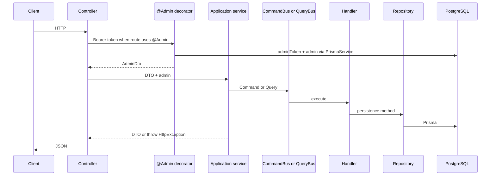

# 00 — Project Overview

## How to Use This Document

Start here for orientation. Implementation detail lives in the linked files under [Quick-start index](#quick-start-index). Prefer repository source over this document when they diverge. Mark anything not confirmed in source as **Unknown**.

Do not copy secrets from `backend/src/main.ts` or `backend/src/shared/helpers/tools.helper.ts` into docs, chat, or new files.

## Project purpose

**Verified:** This workspace (`ManualSSO`) contains one NestJS application, package name `backend` (`backend/package.json`). Swagger metadata titles it `sso-buy` (`backend/src/shared/config/swagger.json`). HTTP surface today is admin authentication plus file upload.

**Inferred:** The product direction is a manual SSO registry: an operator (admin) authenticates, then registers client applications (`App`: title, url, access token, active session). The `App` domain types exist. The runnable API does not expose them yet. See [04-domain-design.md](04-domain-design.md).

## Main business capabilities

| Capability | Status | Evidence |
|------------|--------|----------|
| Admin login, logout, password change | Active | `AdminController` in `backend/src/modules/admin/presentation/controllers/admin.controller.ts` |
| Forgot / recover password (SMS OTP stub) | Active route, SMS is a no-op | `AdminService.forgetPassword`, `Tools.sendSmsCode` returns immediately |
| Admin seed from env | Active CLI | `npm run seed:admin` → `backend/src/shared/commands/seed-admin.ts` |
| Media upload and delete | Active | `MediaController`, `MediaModule` imported by root `AppModule` |
| Audit log of writes | Active for media upload/delete | `Tools.saveLogs` → CQRS `CreateLogEvent` |
| Registered SSO apps (`App`) | Active | `AppsModule` under `backend/src/modules/app`, imported by root `AppModule` |
| End-user accounts | Active | `UserModule`: create/grant via app `accessToken`, revoke, login (with apps), password, forget/recover. `@User()` uses `user_tokens` |
| RBAC permission checks | Prepared, unused | `inRoleRoutes` looks for Swagger description `this operation protected by RBAC`. Current operations say `this operation is public`. `@Admin({ operationId })` does not check `operationId` |

## Primary actors

| Actor | How they authenticate | Evidence |
|-------|----------------------|----------|
| Admin | `POST /admins/login` with username + password. Response includes JWT `access_token`. Later calls send `Authorization: Bearer <token>` | `AdminService.login`, `@Admin()` decorator |
| Seed admin | Created once from env `USERNAME`, `EMAIL`, `MOBILE`, `FIRST_NAME`, `LAST_NAME`, `PASSWORD` | `AdminService.seeder` |
| Client application | App `accessToken` in body on public user create/revoke | `POST /users`, `DELETE /users/apps` |
| End user | `POST /users/login` with username + password; Bearer JWT for dash/password/logout | `UserService`, `@User()` |

There is no role enum. Authorization is “valid admin token row + valid JWT”, not a role list.

## Major modules

| Module | Registered in root `AppModule` | Role |
|--------|--------------------------------|------|
| `AdminModule` | Yes | Admin identity, tokens, SMS requests, logs |
| `MediaModule` | Yes | Uploaded files |
| `AppsModule` | Yes | SSO client apps |
| `UserModule` | Yes | End users, `UserApp` grants, user tokens |
| `EventsModule` | Yes | Global `@nestjs/event-emitter` root. Audit logs use CQRS `EventBus`, not this emitter |
| `PrismaModule` | Yes | `PrismaService` connect/disconnect |

## High-level request flow

Audit side effect (media): `Tools.saveLogs` → `EventBus.publish(CreateLogEvent)` → `CreateLogHandler` → `LogRepository.create`.

## External systems

| System | Usage | Evidence |
|--------|-------|----------|
| PostgreSQL | Primary store via Prisma 7 + `@prisma/adapter-pg` | `prisma/schema.prisma`, `PrismaService` |
| Iran SMS service | Intended OTP sender. Methods return before HTTP | `Tools.sendSmsCode` / `sendSms` / `sendBulkSms` |
| Local disk | Uploads under `pathes.staticFiles` + `pathes.uploadedFiles` | `pathes.ts`, `MediaService.upload` |
| Firebase | Commented out | `tools.helper.ts` |

## Runtime entry

- HTTP: `backend/src/main.ts` → `AppModule` → `process.env.APP_PORT`
- Swagger UI: only when `NODE_ENV` lowercased equals `test`, path `/api`
- Seed: `npm run seed:admin` (alias `seed:user`)
- Schema rebuild: `npm run build:schema` concatenates module `*.prisma` files into `backend/prisma/schema.prisma`

## Quick-start index

| Need | File |
|------|------|
| Mandatory engineering process | [12-engineering-rules.md](12-engineering-rules.md) |
| Architecture and request path | [01-architecture.md](01-architecture.md) |
| Libraries and scripts | [02-tech-stack.md](02-tech-stack.md) |
| Where to add a feature | [03-folder-structure.md](03-folder-structure.md) |
| Aggregates and status | [04-domain-design.md](04-domain-design.md) |
| Schema workflow and relations | [05-database-design.md](05-database-design.md) |
| Fields per model | [06-database-models.md](06-database-models.md) |
| Commands, queries, events | [07-cqrs-rules.md](07-cqrs-rules.md) |
| Coding rules | [08-coding-rules.md](08-coding-rules.md) |
| Repositories and Prisma access | [09-query-dataAccess-rules.md](09-query-dataAccess-rules.md) |
| HTTP design | [10-api-design.md](10-api-design.md) |
| Swagger | [11-api-documentation.md](11-api-documentation.md) |

## Known gaps (do not invent)

- No frontend in this workspace.
- No `*.spec.ts` or e2e specs.
- No `prisma/migrations` directory. README uses `prisma db push`.
- `App` is not in the generated `schema.prisma`. `app.prisma` is invalid Prisma (`mediaId?` instead of `Int?`) and is not wired.
- `src/modules/app/app.module.ts`, `application/services/app.service.ts`, `infrastructure/repositories/app.repository.ts`, and `presentation/controllers/app.controller.ts` are copies of the admin feature and import admin files that do not exist under `modules/app`.
- `LeakyService` grows memory on a timer. It is commented out of `AppModule`. Leave it unused.
- `Tools.codeCreator()` returns `1234` and never reaches the random generator.
