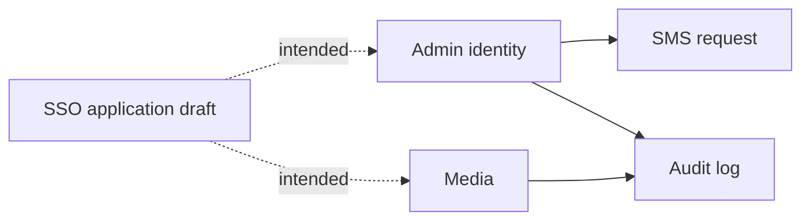

# 04 — Domain Design

## How to Use This Document

Domain classes here are data holders and interfaces. Business rules live in application services. Do not invent aggregates that are not listed.

## Bounded contexts

| Context | Status | Owner module |
|---------|--------|----------------|
| Admin | Live | `modules/admin` |
| Admin session token | Live | same module, aggregate `AdminToken` |
| SMS one-time code | Live, delivery stubbed | aggregate `SmsRq` |
| Audit log | Live | aggregate `Log` |
| Media | Live | `modules/media` |
| SSO application | Live | `modules/app` |
| End user | Live | `modules/user` |

## Admin

**Entity** `domain/entities/admin.entity.ts`: `id`, `username`, `firstName`, `lastName`, `email`, `mobile`, optional `password`, timestamps, `deletedAt`.

**Invariants enforced in `AdminService` (not in the entity):**

- Login and password change compare bcrypt hashes.
- Unknown username on login returns the same Persian forbidden message as a bad password.
- Unknown mobile on forget-password returns HTTP 500 `خطای داخلی سرور` (does not reveal “not found” on that path; login uses a different message).
- Seed creates one admin when `GetAdminByMobileQuery(process.env.MOBILE)` is empty.
- Password is hashed with `bcryptjs` cost 10 before `CreateAdminCommand` or `UpdatePasswordCommand`.

**Service interface** `AdminServiceImpl`: `seeder`, `login`, `updatePassword`, `forgetPassword`, `recoverPassword`, `logOut`.

**Repository interface** `AdminRepositoryImpl`: `create`, `findById`, `findByMobile`, `findByUsername`, `findByEmail`, `findAll(page, limit)`, `updatePassword`. Implementation also has `allIncludingDeleted`, which is not on the interface.

**Not an HTTP use case:** `RegisterDto` exists. No register route. Admins are seeded.

## AdminToken

Session row for a JWT. Fields: `device`, `ip`, `access_token`, `lastConfirmationId`, `adminId`.

- Created on successful login.
- Deleted by access token on logout (`forceDelete` / `deleteMany`, not a `deletedAt` stamp).
- `@Admin()` treats a missing token row as forbidden even if the JWT signature is valid.

`device` is never set by `CreateAdminTokenCommand` callers that were read (login passes `adminId`, `ip`, `access_token`).

## SmsRq

One row per mobile+ip lookup via `findOne` (first non-deleted row). Fields: `mobile`, `code` (SmallInt), `ip`, `lastSentTime`, `sendCount`, `jwtToken`.

**Rules in `AdminService.forgetPassword`:**

- If a row exists and `sendCount > 4`, return the stored `jwtToken` and do not send.
- Otherwise update code, token, and `sendCount + 1`, then call `sendSmsCode`.
- If no row, create with `sendCount: 1` and call `sendSmsCode`.
- `codeCreator()` returns the constant `1234`.
- `moment.diff` is computed and discarded, so the resend interval is not enforced.

**Rules in `recoverPassword`:**

- Header `recover_pass_token` is required.
- JWT must verify.
- SMS row `code` must equal the body code (number compare).
- Token payload `code` must also equal the body code.
- Then `SoftDeleteCommand` hard-deletes the SMS row and `UpdatePasswordCommand` stores the new hash.

## Log

Append-only audit intended for every mutating use case. Shape: `adminId`, `tableName`, `rowId`, `act` (`DatabaseAct`), `oldData`, `newData`, `description`.

**Verified callers of `saveLogs`:** media upload (`CREATE`, Persian description `آپلود فایل جدید`) and media delete (`DELETE`, `حذف فایل`). Login, logout, and password changes do not write a log.

`DatabaseAct`: `CREATE | UPDATE | DELETE | READ`. Persian labels live in the default export of `databaseAct.enum.ts`.

## Media

**Entity:** `id`, `mediaUrl`, `ownerId`, `ownerModel`, `mimeType`, timestamps, `deletedAt`.

**MIME** from file extension (`Tools.checkMime`): `IMAGE`, `VIDEO`, `MUSIC`, `DOCUMENT`, `APP`, `OTHER`.

**Upload rule (`MediaService.upload`):**

- Multer already stored the file in `{static}/{uploaded}/{filename}`.
- Service creates `{static}/{uploaded}/{dist}/` when missing, copies the file there, deletes the temp file.
- Persists `mediaUrl = {uploadedFiles}{dist}/{fileName}` with `ownerId` and `ownerModel` null.
- Writes an audit log.

**Delete rule:** load by id. Missing file → 404 `فایل پیدا نشد`. If `ownerId` is set, return `true` without deleting the row or the disk file. If `ownerId` is null, unlink disk and `DeleteMediaCommand` (hard `prisma.media.delete`).

`UpdateMediaOwner` can set `ownerId` + `ownerModel` and is not called.

Upload max size on the controller: `MaxFileSizeValidator` 10_000_000 bytes. MIME is not restricted by `FileTypeValidator` (that validator is commented out).

## App (SSO client)

Live under `modules/app` (`AppsModule`). Entity fields: `title`, `description`, `url`, optional `mediaId`, `adminId`, `status`, `activeSession`, `accessToken`. Many-to-many with `User` via `UserApp`. `activeSession === false` enables bound-session checks via `AppUser` (see User).

## User (end-user SSO)

**Entities:** `User`, `UserApp` (grant join `users_apps`), `UserToken` (session JWT + disposable `publicKey`), `AppUser` (bound session `app_user`: `userId`, `appId`, `access_token`).

**`UserServiceImpl`:** `create` (app `accessToken` gate; match existing by mobile/email/username; grant `UserApp`), `createViaApp` (gRPC; validate App token then reuse `create`; safe response), `revokeAppAccess` (hard-delete join), `login` (apps in DTO), `updatePassword`, `forgetPassword`, `recoverPassword`, `logOut`, `validateUserAppAccess` (gRPC; `valid` + safe user fields, no throw; when `activeSession === false` also match `AppUser.access_token`), `updateStatusByUsernameViaApp` (gRPC), `generateAppPublicKey` (REST; store `UserToken.publicKey`), `getUserByPublicKey` (gRPC; App `accessToken` + `publicKey` → user identity + session `access_token`; when `activeSession === false` replace `AppUser` with current token).

**Create rules:** App must exist and `status === true`. Conflicting identity fields across different users → 409. Existing `UserApp` → idempotent. Password hashed bcrypt cost 10.

**`activeSession === false` (AppUser):** Written only in `getUserByPublicKey` (hard-delete then create with `access_token`). Required on `validateUserAppAccess` with exact `access_token` match. Not used when `activeSession !== false`.

**Repository interfaces:** `UserRepositoryImpl`, `UserAppRepositoryImpl`, `UserTokenRepositoryImpl`, `AppUserRepositoryImpl`.

## Interfaces vs entities

| Kind | Location | Rule |
|------|----------|------|
| Input contract | `domain/interfaces/**` | DTO `implements` the interface |
| Persistence contract | `domain/repositories/*.repository.ts` named `*Impl` | Infrastructure class `implements` it |
| Use-case contract | `domain/services/*.service.ts` named `*Impl` | Application service `implements` it |
| HTTP contract | `domain/controllers/*.controller.interface.ts` | Controller `implements` it |
| Entity class | `domain/entities` | Constructor assignment. Repositories `return row as Entity` without `new Entity()` |

Domain must not import `PrismaService`. The admin domain service interface imports `AdminDto` from presentation. That dependency already exists; new domain interfaces should use domain types, and existing admin signatures stay as they are unless the task is a cleanup.

## IDs and time

Integer `@id @default(autoincrement())` on every current model. `createdAt @default(now())`, `updatedAt @updatedAt`, nullable `deletedAt`. Application code treats `deletedAt: null` as alive. Several deletes ignore that and hard-delete (SMS, media, admin token). See [05-database-design.md](05-database-design.md).
