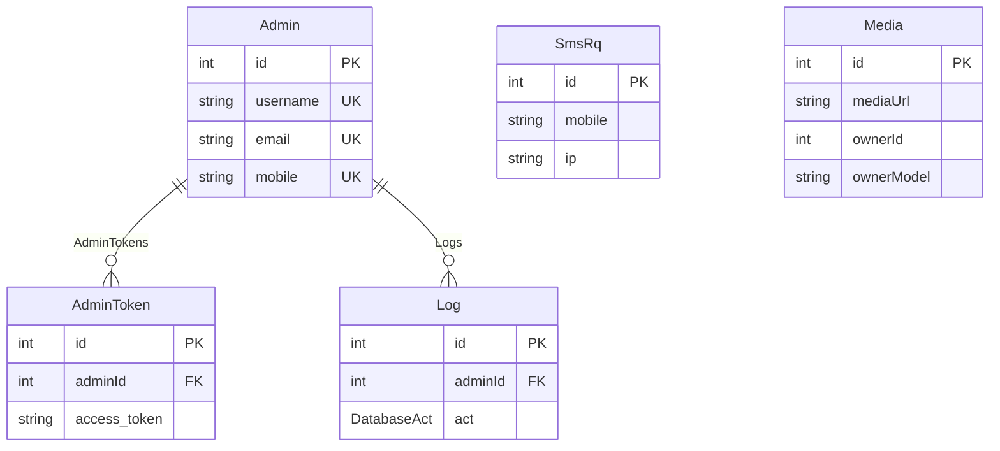

# 05 — Database Design

## How to Use This Document

PostgreSQL via Prisma 7. Field-level tables are in [06-database-models.md](06-database-models.md). Query helpers are in [09-query-dataAccess-rules.md](09-query-dataAccess-rules.md).

## Source of truth

Module files are the source of truth:

```
backend/prisma/base.prisma
backend/src/modules/**/**/*.prisma
```

`backend/prisma/combine.js` walks `src/modules` for `*.prisma`, prepends `base.prisma`, and writes `backend/prisma/schema.prisma`. Then `npx prisma format` runs (`npm run build:schema`).

Edit the module fragment. Regenerate. Do not maintain `schema.prisma` by hand. A hand edit is wiped on the next `build:schema`.

**Verified current generated schema** (`schema.prisma`) contains `Admin`, `AdminToken`, `Log`, `SmsRq`, `Media`, enums `DatabaseAct` and `MimeType`. It does **not** contain `App`.

**Verified `app.prisma`** is on disk and would be concatenated, but it is not valid Prisma (`mediaId?` is not `Int?`, relation fields on `Admin` / `AdminToken` / `Media` are missing). Do not run `build:schema` until that fragment is valid or removed, or the format step fails and can overwrite `schema.prisma` with a broken file.

## Connection

| Setting | Value |
|---------|--------|
| Provider | `postgresql` |
| URL | `DATABASE_URL` in `prisma.config.ts` (`env('DATABASE_URL')`) |
| Runtime | `PrismaPg` adapter in `PrismaService` constructor |
| Migrations | Config points at `prisma/migrations`. Directory absent. README uses `npx prisma db push` |

## Tables (generated schema)

| Model | Table | Soft-delete column |
|-------|-------|--------------------|
| `Admin` | `admins` | `deletedAt` |
| `AdminToken` | `admin_tokens` | `deletedAt` (logout uses hard delete) |
| `Log` | `logs` | `deletedAt` |
| `SmsRq` | `sms_rqs` | `deletedAt` (recover uses hard delete) |
| `Media` | `medias` | `deletedAt` (delete route uses hard delete) |

## Relations (generated schema)



- `AdminToken.adminId` → `Admin.id` (required).
- `Log.adminId` → `Admin.id` (required).
- `SmsRq` has no foreign key.
- `Media.ownerId` + `ownerModel` are a string polymorphic pointer, not a Prisma relation.
- No `onDelete` / `onUpdate` actions are declared. Database defaults apply.

## Enums

Stored as Prisma enums (PostgreSQL enums):

| Enum | Values | Also in TypeScript |
|------|--------|--------------------|
| `DatabaseAct` | `CREATE`, `UPDATE`, `DELETE`, `READ` | `shared/enums/databaseAct.enum.ts` |
| `MimeType` | `IMAGE`, `VIDEO`, `MUSIC`, `DOCUMENT`, `APP`, `OTHER` | `shared/enums/mimeType.enum.ts` and `modules/media/domain/enums/mimeType.enum.ts` |

Keep the Prisma enum and the TypeScript enum in sync. `build:schema` will emit duplicate enum blocks if two `*.prisma` files both declare the same enum. Today `DatabaseAct` is only in `log.prisma` and `MimeType` is only in `media.prisma`.

## Uniqueness

| Model | Unique fields |
|-------|----------------|
| `Admin` | `username`, `email`, `mobile` |
| `AdminToken` | none on `access_token` (column is `VarChar(240)`, not `@unique`) |
| `SmsRq` | none. Lookup is `mobile` + `ip` via `findFirst` |
| `Media` | none |
| `App` draft | `title`, `url`, `accessToken` marked `@unique` in the fragment only |

Login stores JWTs in `access_token`. Length must stay within 240 characters. A longer token fails the insert.

## Soft delete vs hard delete

`PrismaService` read helpers add `deletedAt: null` except `findDeleted` and `findWithDeleted`.

| Operation | Actual SQL behavior |
|-----------|---------------------|
| Admin reads through `findByUnique` / `findOne` / `findAll` | Filter `deletedAt: null` (see gotcha below) |
| Admin password update | `prisma.admin.update` by id, no deleted filter |
| Logout | `deleteMany` on `adminToken` |
| SMS `softDelete` | `prisma.smsRq.delete` (hard delete). The command name says soft |
| Media delete | `prisma.media.delete` |
| `PrismaService.softDelete` | `updateMany` set `deletedAt`. Not used by SMS or media repositories |
| `PrismaService.restore` | sets `deletedAt: null` |

**Gotcha:** `findByUnique` calls Prisma `findUnique` and puts `deletedAt: null` inside `where` together with the unique field. `findUnique` accepts only unique fields. `deletedAt` is not part of any `@@unique`. Callers (`findById`, `findByMobile`, login, `@Admin`) use this helper. Treat runtime failure here as a known defect. New reads of non-unique filters use `findOne` (`findFirst`) or a unique `where` without `deletedAt` inside `findUnique`.

**Gotcha:** `allIncludingDeleted` calls `findAll` with `where: { deletedAt: { not: null } }`. `findAll` then overwrites `deletedAt` with `null`. The method returns non-deleted rows.

## Pagination defaults

`findAll` and `findDeleted`: `orderBy id desc` when omitted, `skip 0`, `take 10`. Repositories that pass `skip`/`take` override the default.

## Indexing

No `@@index` in the generated schema. Filters on `sms_rqs.mobile`, `admin_tokens.access_token`, and `logs.adminId` are sequential scans unless a later migration adds indexes. Add indexes in the module `.prisma` file when a task asks for them.

## App fragment (not migrated)

Intended table `apps` with FKs to `Admin` and `Media`, and a relation list `AdminTokens`. Those back-relations are not on `Admin`, `Media`, or `AdminToken` today. Implementing App requires editing `admin.prisma` and `media.prisma` together so the generated schema has both sides, then `prisma generate` and `db push`.

## Client delegate names

Repositories pass these strings into `PrismaService` helpers, or call the delegate directly:

| Model | Delegate |
|-------|----------|
| `Admin` | `admin` (`this.prisma.admin`) |
| `AdminToken` | `adminToken` |
| `Log` | `log` |
| `SmsRq` | `smsRq` |
| `Media` | `media` |

The string must match the Prisma client delegate, which is camelCase of the model name.
